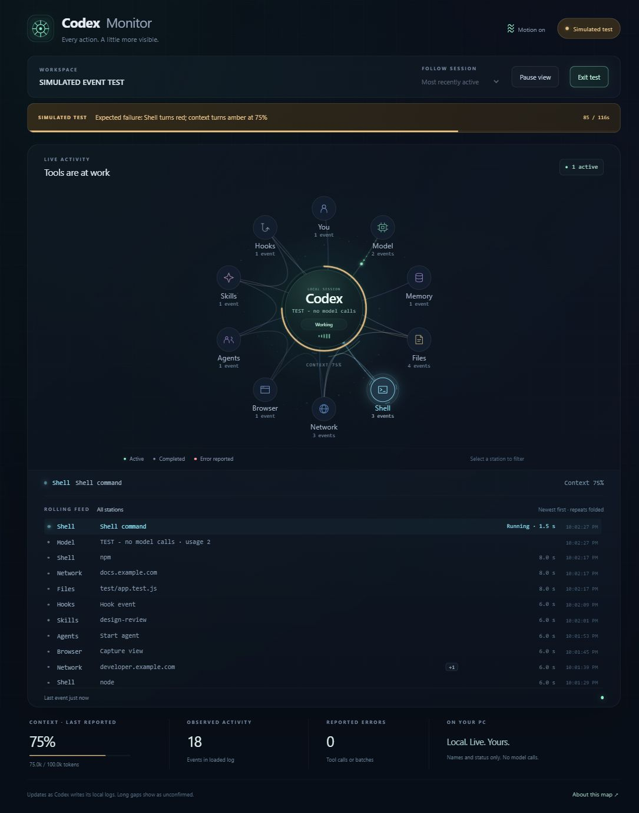

# Codex Monitor

A live map of your local Codex activity, with an animated rolling feed that refreshes every **500 ms**. Runs on your own computer, reads your own session logs, and makes no AI calls.



*Preview uses simulated events only.*

## Get started

Requires **Node.js 22 or newer** and a local Codex installation that writes session logs. A supported [Node.js LTS release](https://nodejs.org/) is recommended. No API key, account connection, npm dependencies, or build step is needed.

1. Select **Code → Download ZIP** on this repository, then extract the ZIP to a permanent folder. You can also clone the repository with Git.
2. On **Windows**, double-click **Start.cmd**. It starts the local service and opens your browser.
3. On **macOS or Linux**, open a terminal in the extracted folder and run `npm run open`.
4. Start a local Codex conversation. Select it under **Follow session** to see its activity.

The default address is **http://127.0.0.1:43187**. The monitor discovers sessions under your own home folder's `.codex/sessions` directory. If your Codex sessions are elsewhere, see [configuration](#configuration).

### Windows desktop icon

Double-click **Create Desktop Shortcut.vbs** once. It creates a **Codex Monitor** shortcut with the included monitor icon and a hidden launcher. Keep the project folder in the same location afterward.

If Windows Script Host or VBScript is unavailable on your computer, use **Start.cmd** or `npm run open`. No PowerShell policy change is needed.

### Foreground mode

```sh
npm start
```

Open the address printed in your terminal. Press **Ctrl+C** in that terminal to stop the server. `Start.cmd`, the desktop shortcut, and `npm run open` use a background server that remains running after you close the browser and stops when your computer restarts. They reuse an existing healthy server on the configured port. Nothing is added to system startup.

## What you can see

- Ten stations: You, Model, Memory, Files, Shell, Network, Browser, Agents, Skills, and Hooks.
- Outbound and returning pulses, station counts, recent tool routes, and clocks for calls open longer than three seconds.
- A rolling feed below the map. Consecutive calls at the same station fold into a `+N` row; click it to expand the individual calls.
- Short folder/file names, website hosts, command types, skill names, elapsed time, errors, and model changes.
- Last-reported context usage, with amber at 70% and red at 90%.

Scroll back in the feed to hold your place. **Back to live** returns to the newest rows. Select a station to filter the feed. **Pause view** freezes the display; Codex continues working. **Motion on/off** controls animation and respects the operating system's reduced-motion preference.

### Try the demo

Select **Test all events** to run a clearly labeled 116-second simulation of all ten stations, grouped calls, parallel activity, two expected errors, model changes, context compaction, and recovery. It works even without Codex installed. **Exit test** returns to your real session. The demo never writes into Codex's logs.

## Configuration

Set environment variables before launching. No `.env` loader is included.

| Variable | Default | Purpose |
| --- | --- | --- |
| `CODEX_HOME` | `.codex` under your home directory | Base directory for Codex data |
| `CODEX_MAP_SESSIONS` | `CODEX_HOME/sessions` | Override the sessions directory directly |
| `CODEX_MAP_PORT` | `43187` | Local port, from 1024 through 65535 |

PowerShell example:

```powershell
$env:CODEX_MAP_SESSIONS = 'D:\Codex\sessions'
$env:CODEX_MAP_PORT = '43188'
node launcher.mjs
```

macOS/Linux example:

```sh
CODEX_MAP_SESSIONS="$HOME/.codex/sessions" CODEX_MAP_PORT=43188 node launcher.mjs
```

Use the launcher or printed address when selecting a custom port. Opening `public/index.html` directly redirects to the default port.

## Privacy and scope

The server listens only on **127.0.0.1**, checks the request Host and Origin, and serves a fixed set of assets. The app has no external frontend assets, analytics, model calls, or remote uploads. It does not modify Codex's settings or logs.

Prompts, replies, reasoning, full commands, URL paths, and tool-result contents are not sent to the browser. The local parser examines tool arguments to identify categories and short names, and examines result status fields to detect failures. Short file names, hosts, workspace names, session identifiers, model names, and timing remain visible locally; these names can still be sensitive when sharing your screen.

This repository contains application code, generated artwork, generic documentation, and synthetic tests/demo data. It contains no live session logs, personal screenshots, or installed desktop shortcuts.

This is an independent project, not an official OpenAI product. The concept is inspired by [alexeyw/lot-map](https://github.com/alexeyw/lot-map); this implementation is independent and does not copy its source code.

## Limitations

- Codex's internal log format can change. Events appear when Codex writes them, which may lag behind the work. The 500 ms refresh does not make delayed log records arrive sooner.
- This is a companion browser window, not a pane inside Codex. Remote-only conversations cannot be monitored unless their logs are available locally.
- Model rows count distinct usage reports, not timed model requests. Context is the last reported input-token count divided by the reported window.
- Agent orbits represent agent tool calls in progress, not the entire lifetime of child agents. Hooks and skills light up only when their activity is identifiable in the log.
- Nested calls share their parent batch's completion time. A batch error does not identify which nested call failed.
- A call with no completion record becomes unconfirmed after 90 seconds. An interrupted turn leaves unmatched calls marked unknown.
- Large sessions load the most recent 6 MiB; counts cover the loaded portion. The UI retains 160 events and shows up to 60 grouped feed rows. Error badges count errors in retained events.
- The desktop launchers have been exercised on Windows. Cross-platform Node tests run through GitHub Actions; macOS/Linux desktop integration may differ.

## Troubleshooting

**No sessions found:** start a local Codex chat and check `CODEX_HOME` or `CODEX_MAP_SESSIONS`. You can still run the simulated tour.

**The wrong chat is active:** choose a specific session. “Most recently active” follows the newest log file timestamp.

**Port occupied or page cannot connect:** run `npm start` to see the error, or choose another `CODEX_MAP_PORT`. Avoid opening the HTML file directly when the service is stopped.

**Desktop shortcut stopped working:** the project folder may have moved. Remove or rename the old shortcut and run **Create Desktop Shortcut.vbs** from the new location.

## Development

```sh
npm test
npm run check:release
```

There are no third-party runtime or test dependencies. See [CONTRIBUTING.md](CONTRIBUTING.md) for how to contribute without sharing private session data. The Node test matrix covers Windows, macOS, and Linux on Node 22, 24, and 26.

License: [MIT](LICENSE). The included icon was generated with an image-generation tool; see [asset notes](docs/assets.md).
