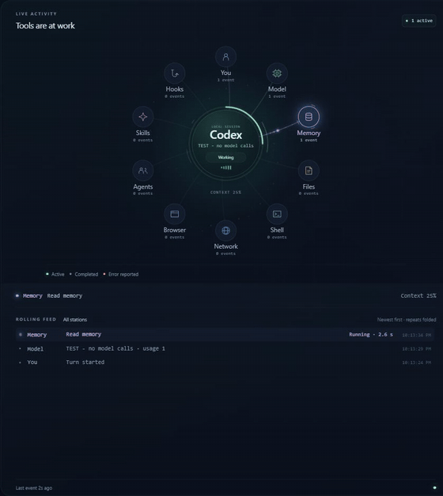
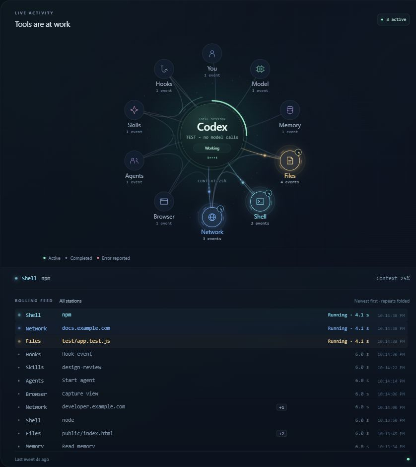
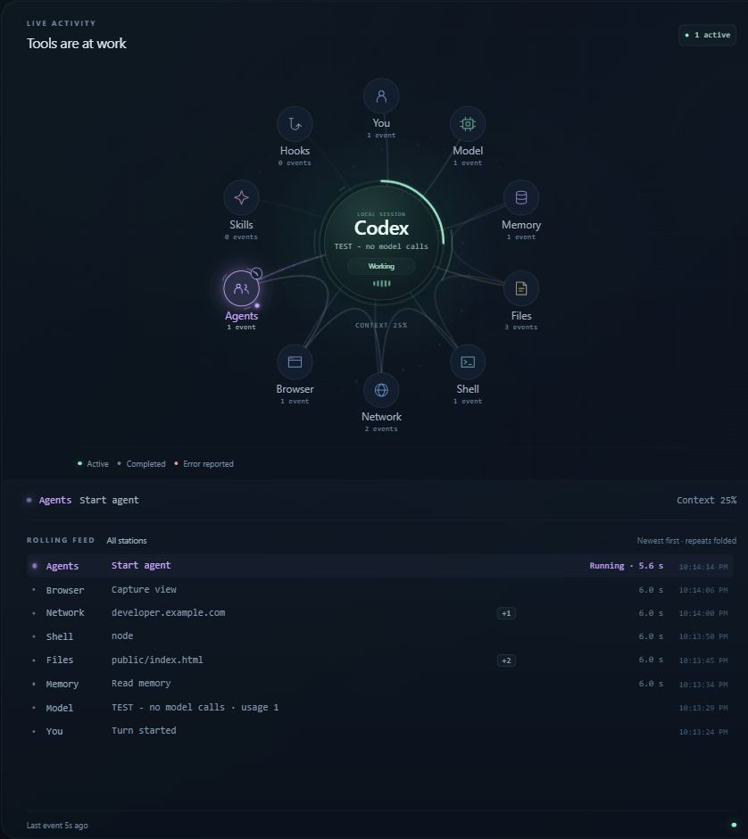
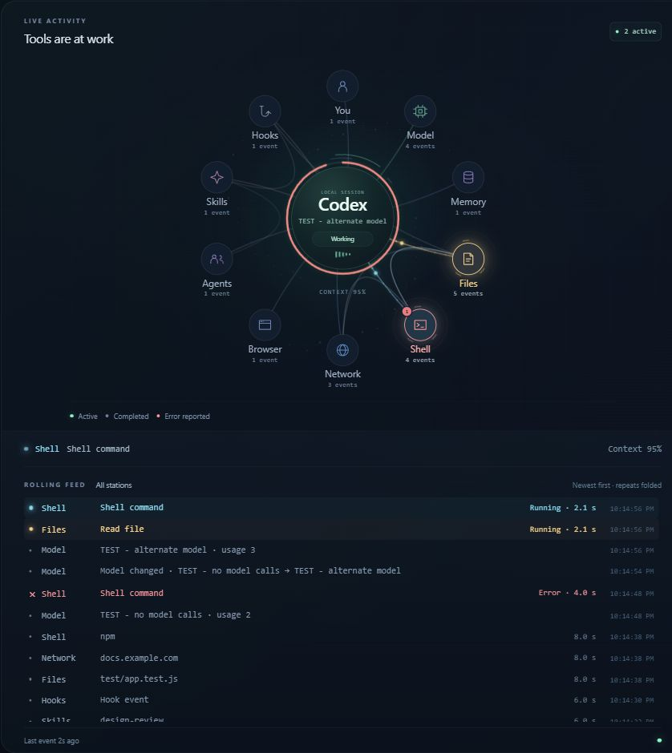

# Codex Monitor

A local companion for Codex: watch tools, files, web activity, and agent calls move around a live map. The rolling feed underneath refreshes every **500 ms**, groups repeated activity, and shows short names and timing. No API key, runtime dependencies, or model calls.



Demo data only, captured from the running app and played at 4× speed. [Watch the video](docs/demo.mp4) · [Full screenshot](docs/demo.jpg).

## Install

Download the project with **Code → Download ZIP** and extract it. Install [Node.js 22 or newer](https://nodejs.org/) if needed, then:

- **Windows:** double-click **Start.cmd**. For the included desktop icon, run **Create Desktop Shortcut.vbs** once.
- **macOS / Linux:** open a terminal in the extracted folder and run:

```sh
npm run open
```

Your browser opens at **http://127.0.0.1:43187** with **Auto-follow active chats** enabled. Start a local Codex chat: the monitor checks for new and resumed sessions every **500 ms** and follows the most recently updated log automatically. The app finds your own `.codex/sessions` directory. [Setup details and troubleshooting](docs/setup.md).

**Test all events** runs a 116-second simulation, including grouped calls, parallel work, context warnings, and two expected errors. After showing the result for five seconds, it returns to live monitoring automatically. You can try it without Codex installed.

## Updating

Download and extract the new version, then restart the local service. Git users can update their clean checkout with:

```sh
git pull --ff-only
```

With `npm start`, stop the old server using **Ctrl+C**, update, and run it again. A background launcher reuses a running server, so restart that server or your computer to load backend updates. If the project folder moved, recreate the desktop shortcut. See [CHANGELOG.md](CHANGELOG.md).

## Stations

| Station | Observed activity |
| --- | --- |
| You | A turn begins, or a tool asks for input |
| Model | Distinct usage reports, model changes, and turn completion |
| Memory | Recognizable memory tools and context compaction |
| Files | File tools, patches, images, and recognized file-reading commands |
| Shell | Other shell commands and unclassified tools |
| Network | Web requests, searches, connected services, and recognized network commands |
| Browser | Browser and computer-use tools |
| Agents | Agent creation, messages, waits, and other agent tool calls |
| Skills | Recognizable skill tools or reading a skill file |
| Hooks | Tool events identifiable as hooks |

These categories come from the local log's tool names and limited argument inspection. They describe observed calls, not everything a program might do internally.

## Reading the map

- **Pulses** travel toward a station when work starts and return when it finishes. In-progress work keeps moving; errors appear in red.
- **Spokes and routes** show where work has gone. Spokes grow with usage; a curved trail connects recent tool stations.
- **Clock hands** appear after a call stays open for three seconds. Agent tool calls also animate a small orbit at the Agents station.
- **Context** is the last reported token usage. The center ring becomes amber at 70% and red at 90%.
- **The rolling feed** puts new activity at the top. A `+N` button expands repeated consecutive visits to one station. Scroll back to hold your position; **Back to live** resumes following the newest activity.
- **Controls** let you pin a session, filter by station, pause the display, or turn motion off. Reduced-motion system settings are respected.
- **Auto-follow** keeps looking for chats even while the display is paused or showing the demo. Selecting a particular session deliberately pins that tab; **Resume auto-follow** turns automatic switching back on. Fresh views and old session links default to auto-follow. A blank chat becomes visible once Codex writes its local log.

| Parallel activity | Agent tool call | Context warning |
| --- | --- | --- |
|  |  |  |

Codex's log data differs from Claude Code's event API. Model rows represent usage reports, agent orbits cover tool-call duration, and nested calls share their parent batch's completion time. [Full limitations](PRIVACY.md#limitations).

## Options

Set these environment variables before opening the monitor:

| Variable | Default | Changes |
| --- | --- | --- |
| `CODEX_HOME` | `.codex` under your home folder | Codex's base data directory |
| `CODEX_MAP_SESSIONS` | `CODEX_HOME/sessions` | The session-log directory directly |
| `CODEX_MAP_PORT` | `43187` | The localhost port, 1024–65535 |

There is no `.env` loader. [Configuration examples](docs/setup.md#configuration).

## What stays local

The server listens only on `127.0.0.1`. It reads local logs without changing them. It sends the browser short names, status, counts, timing, and context usage; it excludes prompts, replies, reasoning, full commands, URL paths, and tool-result contents. It makes no external requests and adds nothing to your conversations. [Privacy details](PRIVACY.md) · [Security](SECURITY.md).

The files and previews in this repository contain only application code, generated artwork, generic documentation, and synthetic test data. No personal logs or real-session screenshots are included.

## Developing

```sh
npm test
npm run check:release
```

No dependency install or build step is required. Automated checks cover the parser, privacy projection, grouped feed, simulation, configuration, and local HTTP boundary. The CI matrix runs on Windows, macOS, and Linux with Node 22, 24, and 26. [Contributing](CONTRIBUTING.md).

## License and credit

[MIT](LICENSE). Inspired by [alexeyw/lot-map](https://github.com/alexeyw/lot-map), with an independent implementation for Codex. Not an official OpenAI product. [Artwork details](docs/assets.md).
